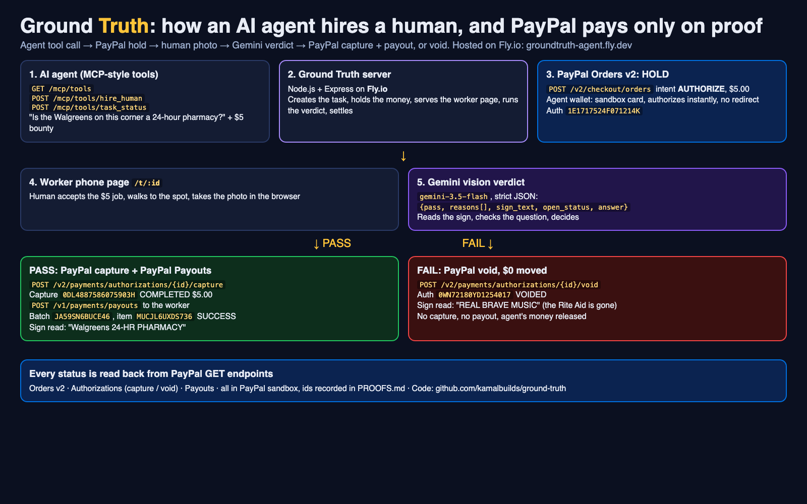
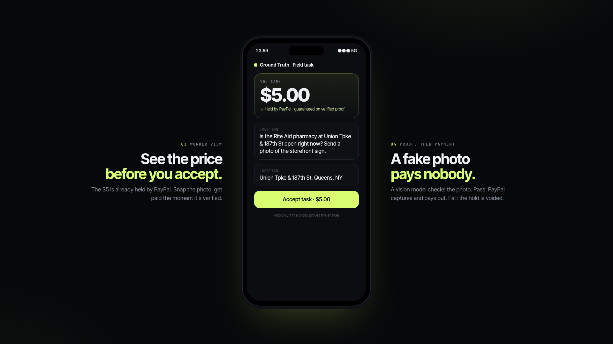
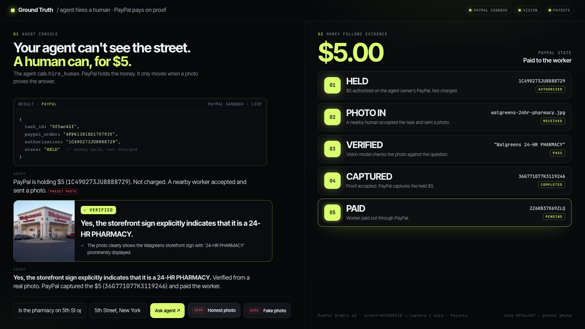
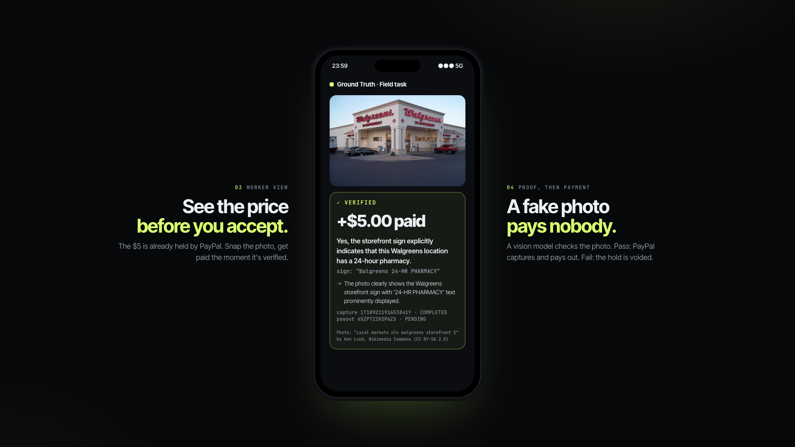
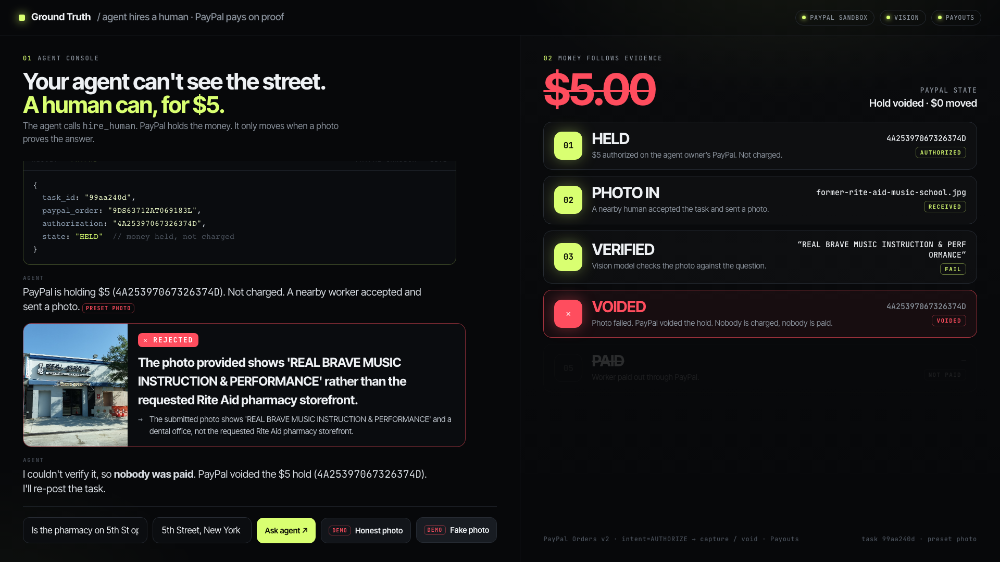

# Ground Truth

**Tagline:** Your AI agent hires a human for $5. PayPal only pays when the photo proves it.

**Live demo:** https://groundtruth-agent.fly.dev/ | **Code:** https://github.com/kamalbuilds/ground-truth | **Proofs:** [PROOFS.md](https://github.com/kamalbuilds/ground-truth/blob/main/PROOFS.md)

## An agent can't see the street

AI agents can book, buy and write code. Ask one "Is the pharmacy on this corner open all night?" and it is stuck. It has no eyes on the physical world.

People are already renting out their eyes to agents: RentAHuman passed 787k profiles after launching in February 2026 ([rentahuman.ai/about](https://rentahuman.ai/about)). What that market is missing is trust in both directions. The agent needs to know it only pays for the truth. The human needs to know they get paid when they deliver it.

**Ground Truth makes PayPal that trust layer.** The agent hires a human with one tool call. PayPal holds the money. A vision model checks the photo. PayPal releases the money only when the photo proves the answer.

## The $5 that waits for proof

1. The agent calls one tool: `hire_human(question, location, budget)`.
2. PayPal **authorizes** $5 from the agent's wallet with Orders v2 `intent: AUTHORIZE`. The money is held, not spent.
3. A nearby human sees the task and the price on their phone, accepts, and takes the photo.
4. Gemini reads the photo against the question and returns a strict JSON verdict: `{pass, reasons[], sign_text, open_status, answer}`.
5. **PASS:** PayPal **captures** the hold and **PayPal Payouts** sends $5 to the worker. **FAIL:** PayPal **voids** the hold and $0 moves.
6. The agent gets its answer, the photo, the verdict and every PayPal id as proof.

The AI makes the judgment. PayPal enforces it.

## Watch it happen: a pass

The agent asks: *"Is the Walgreens on this corner a 24-hour pharmacy?"* The worker's photo shows the sign. Gemini reads **"Walgreens 24-HR PHARMACY"**, returns `open_24h`, and the money moves in seconds.

| Step | PayPal id | Status |
|---|---|---|
| Order (AUTHORIZE, $5.00) | `6MF32331JX0568151` | COMPLETED |
| Authorization (hold) | `1E1717524F071214K` | CAPTURED |
| Vision verdict | gemini-3.5-flash | PASS, `open_24h` |
| Capture | `0DL4887586075903H` | COMPLETED, $5.00 |
| Payout batch | `JA59SN6BUCE46` | SUCCESS |
| Payout item | `MUCJL6UXDS736` (transaction `38171714HM628944X`) | SUCCESS |

The worker sees the $5 land in their PayPal account:

## Watch it fail safely

The agent asks: *"Is the Rite Aid pharmacy at Union Tpke & 187th St open right now?"* The photo comes back showing **"REAL BRAVE MUSIC INSTRUCTION & PERFORMANCE"**. The Rite Aid is gone. Gemini returns `permanently_closed` and FAIL, and PayPal voids the hold. Nothing is captured, nobody is paid, and the agent gets the truth for free.

| Step | PayPal id | Status |
|---|---|---|
| Order (AUTHORIZE, $5.00) | `858934516D435681K` | COMPLETED |
| Authorization (hold) | `0WN72180YD1254017` | VOIDED |
| Capture / payout | none | $0 moved |

The fail case is the feature: a wrong or fake photo costs the agent nothing.

## Under the hood

- **Agent tools (MCP-style HTTP endpoints):** `GET /mcp/tools` lists the tools and input schemas, `POST /mcp/tools/hire_human` posts a task and places the PayPal hold, `POST /mcp/tools/task_status` returns the verdict and every PayPal status. Any agent can plug in.
- **Server:** Node.js + Express with multer for photo uploads, hosted on **Fly.io**. The worker gets a phone page at `/t/:id`.
- **Vision:** Google Gemini `gemini-3.5-flash` via the REST API with `responseMimeType: application/json` and temperature 0, with an ordered fallback list of Gemini models for capacity.
- **Safety in code, not in the prompt:** a task settles exactly once (uploads are refused unless the task is still HELD), the capture amount is the task's own budget, and any vision error resolves to FAIL, which voids the hold. Money only moves on a verified PASS.

## Built on PayPal

- **Orders v2:** `POST /v2/checkout/orders` with `intent: AUTHORIZE` and a card payment source, so the agent's hold is placed in one call with no buyer redirect. Built for agents that can't click "Approve".
- **Authorizations:** `POST /v2/payments/authorizations/{id}/capture` on PASS, `POST /v2/payments/authorizations/{id}/void` on FAIL.
- **Payouts:** `POST /v1/payments/payouts` pays the worker straight to their PayPal account.
- **Read-back:** every write is confirmed with a GET (`/v2/checkout/orders/{id}`, `/v2/payments/authorizations/{id}`, `/v2/payments/captures/{id}`, `/v1/payments/payouts/{batch}`). The UI only shows the status PayPal returns. Every id on this page is a real PayPal sandbox id.

Authorize-then-capture turns "trust the worker" into "trust the evidence". That is the primitive agent commerce needs.

## Where it goes next

- Worker reputation and location proof with EXIF time and GPS checks.
- Disputes routed through PayPal.
- More task types: deliveries, inspections, "does this listing exist".
- A marketplace where any agent framework hires verified humans through one PayPal-backed tool.

## Photo credits

- "Local markets nlv walgreens storefront 2" by Ken Lund, Wikimedia Commons, CC BY-SA 2.0.
- "Union Tpke 187th St (2022-07-03) 03 - Real Brave Music School (Former Rite Aid)" by Tdorante10, Wikimedia Commons, CC BY-SA 4.0.
